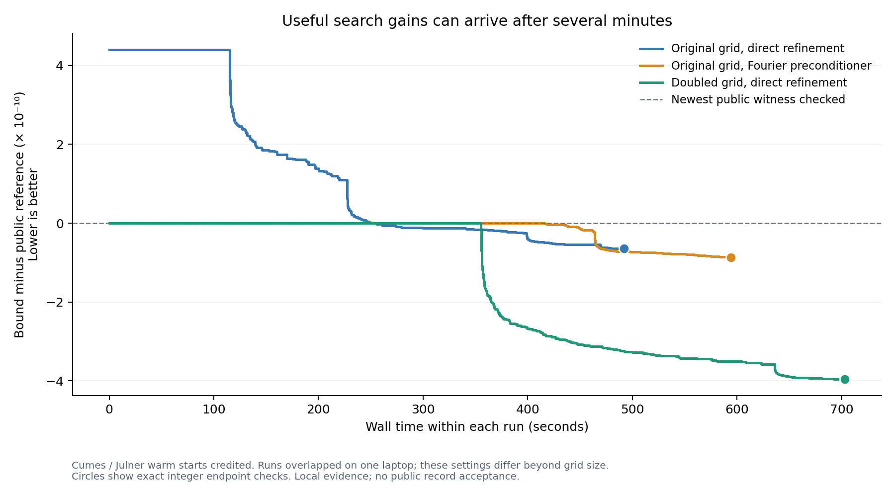

# Unstuck

A Codex-driven mathematical research loop that turns stagnation into evidence about what to try next.

Unstuck proposes a hypothesis, writes and revises search programs, runs bounded experiments, preserves failures and promising states, and checks results with an independent mathematical verifier. It explores continuous optimization and combinatorial constructions.

## Verified result

A nonnegative 524,288-step construction gives the first-autocorrelation upper bound **1.502664832779270…**.

Exact value:

`735013314062726218951303444351680512 / 489139892029864204530610300746273441`

This improves the newest public witness checked by approximately **3.9553 × 10⁻¹⁰**. It is a small numerical refinement of the **L. S. Cumes / Mats Heming Julner (Escapement)** construction, not a new function family. Our exact implementation, the prior author's verifier and the official arena replay agree. See [the exact certificate](results/first-current-finer/exact-verification.json), [integer witness](results/first-current-finer/candidate-integers.txt.gz), [source attribution](data/c1a-current/provenance.json) and [full evidence](START-HERE.md).



The doubled-grid run first improved after 355 seconds. That motivates studying delayed rewards in research allocation; it does not prove that our controller is superior.

## Structural exploration

The larger target is a **227-word, length-16 two-deletion code**, beyond the checked public leader of 226. **We have not found 227 words.**

Completed finite checks found that the source parent's feasible one-word neutral component has exactly two states; none of 496 pair unions of credited public/symmetry parents exceeds 226; and the pool of all outsiders with at most two parent blockers cannot contain 227, even with unlimited parent removals. These are restricted-family conclusions, not global upper bounds.

Those failures drove program changes: cross-layer destruction/repair, conflict-allowing tabu search, guided penalties, larger exact recombination and an outsider-exchange representation. [Structural research](structural/README.md) records hypotheses, predictions, falsification tests and prior art. A controlled comparison of allocation/controller choices remains ongoing; no general autonomous-discovery or controller-superiority claim is made.

## Reproduce the exact result

```sh
python3 -m venv .venv
.venv/bin/pip install -r requirements.txt
.venv/bin/python verify.py --exact-first results/first-current-finer/candidate-integers.txt.gz
```

The verifier computes every convolution coefficient by carry-free integer squaring and directly rechecks selected coefficients. The supplied integer witness replays exactly; floating optimization paths may vary by machine. [More commands and dependencies](REPRODUCTION.md).

## Research loop and limits

Codex is the outer proposer in the recorded work: it inspects outcomes and writes program revisions. Individual scripts use explicit numerical/combinatorial methods. Independent verifiers remain fixed; infeasible low-conflict states are search evidence, never valid code scores. There has been no public arena or Tao acceptance, and the prior-art search is not an exhaustive worldwide priority check.

Program evolution, archives and local search have substantial prior art, including [CPro1](https://github.com/Constructive-Codes/CPro1), [AlphaEvolve](https://github.com/google-deepmind/alphaevolve) and [ShinkaEvolve](https://github.com/SakanaAI/ShinkaEvolve). Those ingredients are not claimed as new. Public construction authors and source IDs are preserved with the data. Third-party Turán certificate/checker code retains Dennis Koshta's MIT licence in `data/c42/LICENSE`; its analytic reduction is unrefereed and our Turán trial is superseded by a stronger open proposal.

Built during the November 2026 Iterate AI Research Hackathon with Codex, Python/C++, NumPy/SciPy and OR-Tools. This is a clean publication snapshot of Track 1 work; it excludes private brainstorming, meetings, session exports and credentials.
