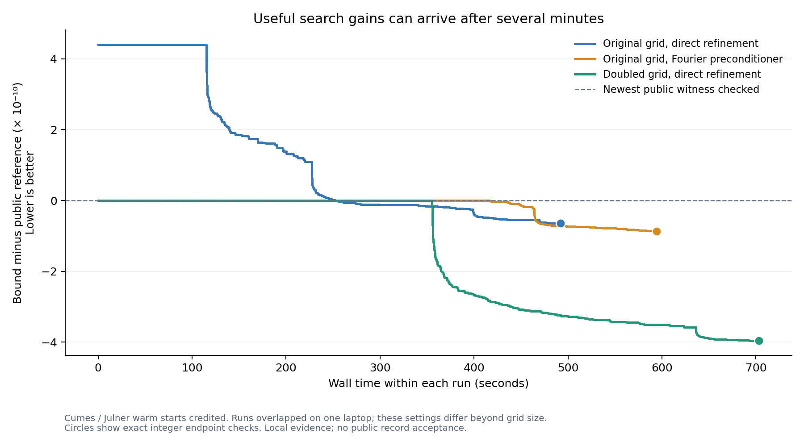

# Track 1: mathematical record search

**Resumed with a higher-risk objective:** pursue a 227-word two-deletion code and a loop that develops and tests search programs, rather than ending at a tiny known-family refinement. [Live structural research and evidence](structural/README.md). The earlier exact C1a result below remains a completed checkpoint, not the current completion criterion.

Research checkpoint, November 15, 2026.

## Verified result

A nonnegative 524,288-step first-autocorrelation witness has exact value

**735013314062726218951303444351680512 / 489139892029864204530610300746273441 = 1.502664832779270…**

This is **3.9553 × 10⁻¹⁰** below the newest public witness checked (Julner / Escapement, 1.502664833174796…, itself a refinement of L. S. Cumes's construction). This is a small numerical refinement, not a new construction. The first run started from Julner's previous witness; the two later runs started from his newest witness. The best run repeats each source cell twice, preserving the original function, then refines at doubled resolution.

- [Exact certificate and comparison](results/first-current-finer/exact-verification.json)
- [Integer witness](results/first-current-finer/candidate-integers.txt.gz), uncompressed SHA-256 `e249d6d96d7a8e80d0e8765a333222325dbd5336a60c261e4ea915235f34561f`
- [Prior author's unchanged verifier agrees](results/first-current-finer/upstream-verifier.txt). Both exact implementations use carry-free polynomial squaring; ours was written before reading that verifier. Direct selected-knot sums and small brute-force controls also passed.
- [Official arena verifier replay](results/first-current-finer/arena-official-replay.json) gives 1.5026648327792707. A fresh leaderboard at 20:36 UTC still has 1.502743486709583, so the margin over that board is about 7.86539 × 10⁻⁵. **Almost all of that board margin comes from the credited prior work**, while our own incremental margin is 3.9553 × 10⁻¹⁰ against the stronger public witness.
- [Source data and provenance](data/c1a-current/provenance.json), [source PR and independent public replay](https://github.com/teorth/optimizationproblems/pull/367#issuecomment-6878835804).

The certificate is locally verified; **no public arena or Tao submission has been made**, and this is not a claim of exhaustive worldwide priority. All three C1a runs have finished and their rounded integer witnesses passed our exact verifier. The winning doubled-grid run took about 703 seconds; its first accepted gain appeared after 355 seconds. The original-grid direct and Fourier runs took 492 and 594 seconds. These configurations also differ in smoothing schedule and warm start, so this is not a controlled causal estimate of grid-size effects. No paid GPU/model run has started.

A Turán certificate below the merged table entry passed two rigorous checkers, but is superseded by a stronger open proposal and is not a record.

## Baseline evidence

Eight downloaded leading constructions reproduce under their current official public verifiers:

| Problem | Source | Score | Status |
| --- | --- | --- | --- |
| Second autocorrelation | MLAI_YONSEI, solution 2783 | 0.963661562062085 | Official replay and independent FFT agree |
| Third autocorrelation | Atris, solution 2617 | 1.449109789331911 (arena only) | Replays, but fails the mathematical max-absolute norm; see below |
| First autocorrelation | Atris, solution 2615 | 1.5027434867095835 | Official replay and independent FFT agree |
| Flat polynomials | apollo-preview, solution 2649 | 1.2594571732205586 | Official million-point replay agrees |
| Hadamard determinant, order 51 | kgrey, solution 2784 | 43.33745596194037 | Exact integer public verifier replay agrees |
| Two-deletion code, length 16 | kgrey, solution 2778 | 226 | Exact string public verifier replay agrees |
| Minimum overlap | Blob, solution 2643 | 0.38085625977797655 | Official replay agrees |
| Snake in the 13-cube | kgrey, solution 2779 | 2950 | Exact public verifier replay agrees |

These are **other agents' constructions**, not our results. Snapshot metadata and public verifier source are in `data/`. Source APIs: [problems](https://einsteinarena.com/api/problems), `/api/problems/{slug}`, `/api/solutions/best?problem_id=ID`, `/api/leaderboard?problem_id=ID`.

## Experiments

- Autocorrelation: independently derived FFT gradients passed finite-difference checks on random small inputs. Soft-max continuation with L-BFGS-B, mean normalization, nonnegativity where required, and unsmoothed acceptance. Initial coarse continuation, sharper continuation and doubled-resolution third-autocorrelation pilots have not beaten the seed. Decisions and timings are in `results/*/decisions.jsonl`.
- Two-deletion code: exact set packing over all 65,536 words. Every adjacent two-weight-layer repair, freezing the incumbent outside that band, is proved optimal at 226 (including a longer follow-up on band 5). Three-layer repairs at starts 0–3 and 11–14 are also proved optimal at 226; middle bands remain unresolved within finite time limits. This is a restricted neighbourhood result, not a global bound. The four-blocker/20-removal repair timed out at 226 with bound 245. Any larger code gets an independent exact string check before saving.
- Hadamard: floating diagnostics found no improving individual row/column sign replacement or single-entry flip. Exact determinant replay passed. Do not spend a long run on naive single-flip search.
- Prime-number-theorem candidate was inspected and deferred: its public checker samples constraints and the seed uses a tolerance near 1.0001. We will not call a sampling/tolerance artifact a new mathematical bound.

- Turán C42: inspecting a MIT-licensed certificate from Dennis Koshta. Lowering its cutoff from 41/200 to 51/250 and contracting its early/middle power sums gives a heuristic finite-n estimate below a candidate bound of 0.68733. **Both independently written rigorous checkers passed**, with |Y|/D enclosed near 0.68731845827196348. However, [open PR #327](https://github.com/teorth/optimizationproblems/pull/327) already proposes 0.686360751, so this is **not a new record**. The merged table is stale. The source construction, analytic argument, original certificate and checkers are credited under `data/c42/`.
- Minimum overlap: independently derived FFT gradients passed finite differences (error below 7e-11); projected optimization on the box/mean constraint has not improved the source seed.
- Snake: finite tail-repair search in both orientations found no extension of the 2,950-edge seed; large neighbourhoods hit the node limit and are not exhaustive.

## Verifier and freshness findings

The official signed-third-autocorrelation checker computes `abs(max(c))`, while the mathematical L-infinity norm is `max(abs(c))`. Its current leader has mathematical value about **4.6126721391**, despite an official score 1.4491097893. The initial third-autocorrelation experiments reproduced the arena objective; no improvement was found. Future third searches now use the mathematical absolute maximum. Do not present the arena score as a mathematical upper bound.

The merged Tao table also lags several pending proposals. We checked the first 100 open issues/PRs and discovered [#367](https://github.com/teorth/optimizationproblems/pull/367): first autocorrelation 1.5026648336, refining L. S. Cumes. We downloaded its witness with SHA-256 verification and are refining that stronger public warm start. Copying it alone is not our contribution.

## Next decisions

1. Check code-repair result; enlarge or restructure the neighbourhood if the small model proves unproductive.
2. Consider independent starting basins and finer functional resolution rather than repeating failed smoothing schedules.
3. Verify every genuine improvement using the official verifier and refresh the live incumbent before calling it record-beating. Distinguish a local verifier result from public acceptance and a literature record.
4. Distinguish local verification from public acceptance and worldwide priority.

## Reproduction

Use an isolated Python 3.11 environment and `requirements.txt`. Local CPU only at present. `verify.py` replays current snapshots; `search.py --check-gradient` checks derived derivatives; `search.py --kind third --name example --seconds 120` starts a finite recorded pilot. Source warm starts and verifier hashes must accompany any result.

## Submission-ready explanation (draft)

**What the system does.** An agent runs a sequence of bounded mathematical searches, reproduces public seeds, and checks whether apparent gains survive the correct mathematical definition, exact arithmetic and a current prior-art comparison. It reallocates effort after failed searches, a verifier mismatch and a stale table entry. The scripts themselves use a fixed menu of numerical/combinatorial methods; they do not train a proposer or modify their own source.

**What this run found.** A tiny exact refinement of the first-autocorrelation bound, plus exact restricted no-improvement results for deletion-code repair. The signed-third arena objective misses negative peaks, and the merged Turán table lags a stronger open proposal; neither apparent result is presented as a record.

**Two-minute demo.** Show the initial failed seed refinements (20 seconds), the verifier/freshness gates rejecting two false record claims (30 seconds), the C1a optimization log (25 seconds), the integer witness passing exact checks (30 seconds), and the two margins with explicit source credit (15 seconds). A full verification takes seconds to tens of seconds on this laptop; the winning search took about 703 seconds. 

## Search comparison

The accepted maximum stayed flat for 355 seconds in the doubled-grid run and 416 seconds in the Fourier run, before improvement began. This supports testing allocation policies with delayed rewards; it does not establish that a particular bandit or learned scheduler is better. No such scheduler was trained in this project. [Machine-readable comparison](results/search-comparison.json).
